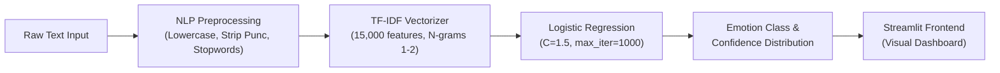

<div align="center">

# 🧠 NLP Emotion Classification Studio
### Multi-Class Emotion Detection using Bag-of-Words & TF-IDF Vectorization

[](https://www.python.org/)
[](https://streamlit.io/)
[](https://scikit-learn.org/)
[](https://www.nltk.org/)
[](https://opensource.org/licenses/MIT)

<p align="center">
  <b>An end-to-end Machine Learning NLP system that classifies natural text into six primary human emotions with real-time confidence distributions and interactive web visualization.</b>
</p>

[Key Features](#-key-features) •
[Architecture](#-model-architecture--pipeline) •
[Quickstart](#-quickstart-guide) •
[Benchmark](#-model-benchmark--evaluation) •
[Project Structure](#-project-structure)

</div>

---

## 📌 Executive Summary

Understanding emotional nuance in text is critical for customer experience analysis, mental health monitoring, social listening, and feedback systems. 

This repository provides a complete, production-grade NLP pipeline:
- **Comprehensive Data Processing:** End-to-end text normalization, punctuation removal, emoji stripping, and stopword elimination.
- **Dual Vectorization Comparison:** Explores **Bag-of-Words (BoW)** vs. **Term Frequency-Inverse Document Frequency (TF-IDF)** with unigrams and bigrams.
- **Model Optimization:** Evaluates **Multinomial Naive Bayes** and **Logistic Regression**, achieving **~88.6% accuracy** on 16,000+ benchmarked text records.
- **Interactive Web App:** A full-featured **Streamlit** dashboard for single inference, batch file classification, and pipeline transparency.

---

## 🎭 Detected Emotion Classes

The model classifies text across 6 distinct emotional spectrums:

| Emotion | Indicator | Description | Typical Cues |
| :--- | :---: | :--- | :--- |
| **Joy** | 😊 | Happiness, triumph, gratitude | *"overjoyed", "thrilled", "blessed", "grateful"* |
| **Sadness** | 😢 | Sorrow, loneliness, grief | *"hopeless", "heartbroken", "down", "empty"* |
| **Anger** | 😡 | Frustration, rage, annoyance | *"furious", "irritated", "disgusted", "fed up"* |
| **Fear** | 😨 | Anxiety, dread, panic | *"terrified", "nervous", "anxious", "scared"* |
| **Love** | ❤️ | Affection, romance, fondness | *"cherish", "adore", "sweetheart", "beloved"* |
| **Surprise** | 😲 | Astonishment, amazement, shock | *"stunned", "unexpected", "amazed", "speechless"* |

---

## ✨ Key Features

### 1. 🎯 Real-Time Emotion Classification
- Immediate inference with confidence scoring across all 6 emotional categories.
- Interactive **Plotly** probability breakdown chart.
- Curated 1-click test presets for quick evaluation.

### 2. 📂 Batch File Processing
- Upload `.csv` or `.txt` datasets containing arbitrary customer reviews, tweets, or messages.
- Automatic bulk prediction with summary analytics (dominant emotion, distribution metrics).
- Download enriched results as an exportable CSV with a single click.

### 3. 🔬 Transparent Preprocessing Inspector
- Step-by-step visual audit of the NLP cleaning stages:
  $$\text{Raw Text} \longrightarrow \text{Lowercase} \longrightarrow \text{Punctuation Free} \longrightarrow \text{Emoji Free} \longrightarrow \text{Stopword Free} \longrightarrow \text{TF-IDF Matrix}$$
- Live display of extracted TF-IDF n-gram weights and feature contributions.

### 4. ⚡ Seamless Model Serialization
- Pre-trained models (`logistic_model.pkl`, `tfidf_vectorizer.pkl`, `emotion_map.pkl`) are pre-packaged and auto-detected out of the box.
- Browser-based `.pkl` upload widget in the UI for plug-and-play evaluation.

---

## 🏗️ Model Architecture & Pipeline



---

## 📊 Model Benchmark & Evaluation

Tested on a held-out test split of 3,200 samples (20% of `train.txt`):

| Feature Extractor | Classifier | Vocabulary Size | Test Accuracy | Status |
| :--- | :--- | :---: | :---: | :---: |
| **Bag-of-Words** (`CountVectorizer`) | Multinomial Naive Bayes | 15,000 | 79.5% | Baseline |
| **TF-IDF** (`TfidfVectorizer`) | Multinomial Naive Bayes | 15,000 | 77.2% | Baseline |
| **TF-IDF** (Unigrams + Bigrams) | **Logistic Regression** | **15,000** | **88.6%** | 🏆 **Production Model** |

---

## 📁 Project Structure

```text
nlp-bow-tfidf-emotion-analysis/
├── .gitignore                              # Comprehensive Python, Jupyter, and Streamlit ignore rules
├── requirements.txt                        # Pinned dependencies
├── train.txt                               # Labeled training dataset (16,000 records)
├── NLP_using_Bag_of_words_and_tf_idf.ipynb # Complete research & experimentation notebook
├── emotion_map.pkl                         # Label index to emotion mapping
├── tfidf_vectorizer.pkl                    # Fitted TF-IDF feature extractor
├── logistic_model.pkl                      # Serialized Logistic Regression model
├── app.py                                  # Production Streamlit web application
└── README.md                               # Project documentation
```

---

## 🚀 Quickstart Guide

### 1. Clone the Repository
```bash
git clone https://github.com/utsav210/nlp-bow-tfidf-emotion-analysis.git
cd nlp-bow-tfidf-emotion-analysis
```

### 2. Set Up Virtual Environment

**Windows (PowerShell):**
```powershell
python -m venv venv
.\venv\Scripts\Activate.ps1
```

**macOS / Linux:**
```bash
python3 -m venv venv
source venv/bin/activate
```

### 3. Install Dependencies
```bash
python -m pip install --upgrade pip
pip install -r requirements.txt
```

### 4. Run the Streamlit Application
```bash
streamlit run app.py
```
*The web dashboard will automatically open at `http://localhost:8501` with the pre-trained `.pkl` models loaded and ready.*

---

## 📓 Jupyter Notebook & Kernel Integration

To run or modify [NLP_using_Bag_of_words_and_tf_idf.ipynb](file:///d:/NLP-Project/NLP_using_Bag_of_words_and_tf_idf.ipynb) using the isolated project environment:

```bash
python -m ipykernel install --user --name nlp-project-kernel --display-name "Python (NLP Project venv)"
```

In Jupyter Notebook or VS Code, select the kernel **`Python (NLP Project venv)`** from the kernel picker.

---

## 🤝 Contributing

Contributions, feedback, and issue submissions are welcome!
1. Fork the Project
2. Create your Feature Branch (`git checkout -b feature/AmazingFeature`)
3. Commit your Changes (`git commit -m 'Add some AmazingFeature'`)
4. Push to the Branch (`git push origin feature/AmazingFeature`)
5. Open a Pull Request

---

## 👤 Author

**Utsav Gandhi**
- GitHub: [@utsav210](https://github.com/utsav210)
- Repository: [nlp-bow-tfidf-emotion-analysis](https://github.com/utsav210/nlp-bow-tfidf-emotion-analysis)
- Email: `utsavgandhi273@gmail.com`

---

<div align="center">
  <sub>Built with ❤️ using Python, Scikit-Learn, and Streamlit.</sub>
</div>
